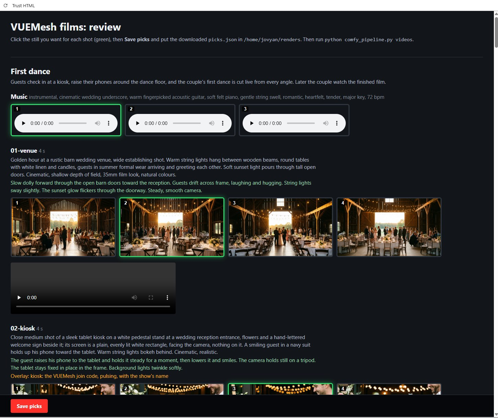
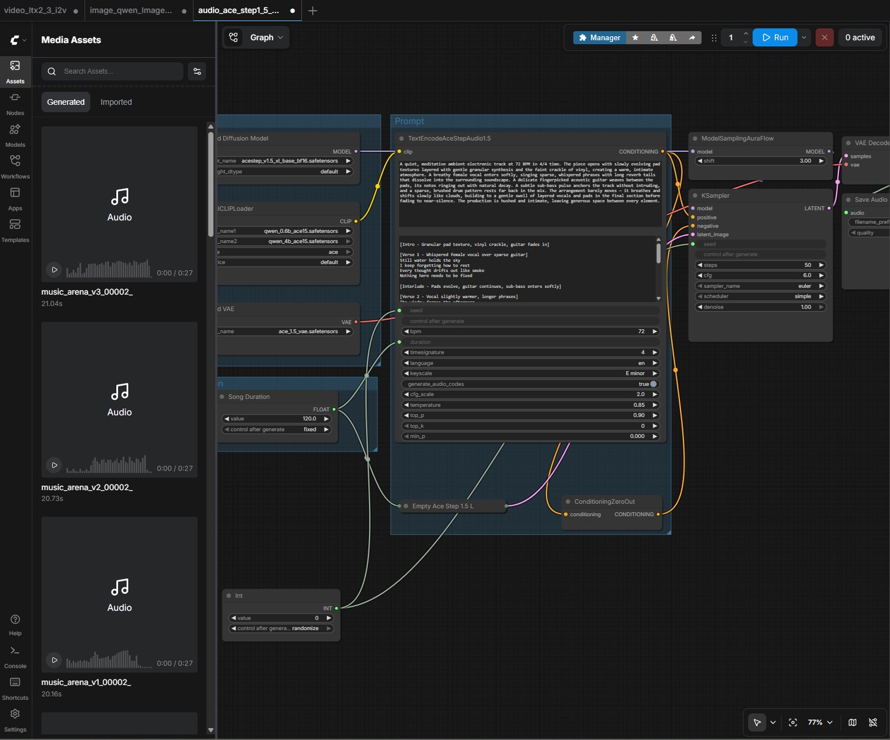
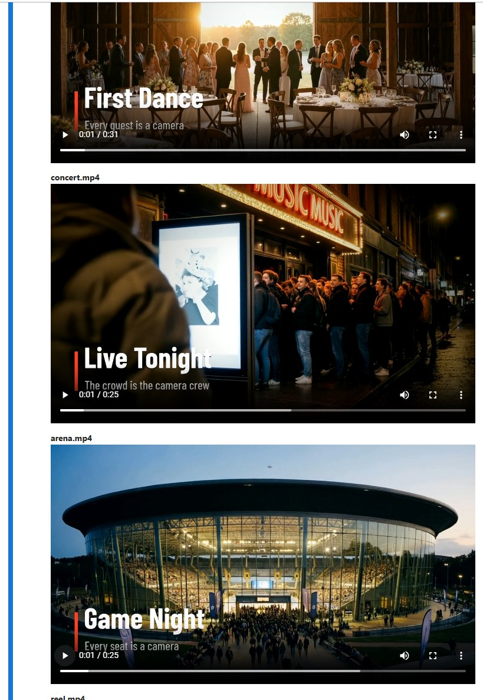

# VUEMesh films: stills, video and music, all through ComfyUI

Three short films that show what VUEMesh is for: a wedding first dance, a concert and an
arena game. Each shot is made in two stages, then the whole thing is cut, scored and titled.

| Stage | Model | What it makes |
|---|---|---|
| Stills | Qwen-Image 2512 | a few still frames per shot, to pick the best from |
| Video | LTX 2.3 image-to-video | each picked still, brought to life with the shot's motion prompt |
| Music | ACE-Step 1.5 XL Base | an instrumental bed for each film, as long as its cut |
| The cut | ffmpeg | trims, speeds, dissolves and flashes, titles, a colour grade, an end card, and the music under it |

One script (`comfy_pipeline.py`) runs all of it through your ComfyUI, from a terminal or from
the notebook (`vuemesh_films.ipynb`). Everything about the films (every shot's prompts, how
each film is cut, each film's music) is in `shots.json`.

The screens in the shots (the kiosk, phones, laptops, the LED wall, the arena's big board) are
left plain white on purpose: the real VUEMesh screens go on afterwards as overlays, so the
codes and the studio are exact and readable. Each shot's `overlay` says what goes there.

## What it looks like

**Pick the best take.** `renders/review.html` shows each film's music takes (play them; the
picked one is outlined in green) and each shot's stills, with its prompts and the overlay it
needs. Click to pick; the notebook has the same pickers.



**The music comes from your own ComfyUI.** This is the ACE-Step 1.5 XL Base workflow, and
(left, in Assets) the takes the pipeline made from it: three for the arena film, each 27
seconds. The `Int` node at the bottom is the seed; the pipeline gives every take its own.
The `Song Duration` node on the left is the length, set from the film's cut.



**The finished films.** The notebook's last cell cuts and plays them: a title over the
footage, each film as long as its edit says (about 25 to 31 seconds), with the picked music
under it.



## Set up once

1. **Python 3.9 or newer** (nothing to install beyond it), and **ffmpeg** for the cut (check
   with `ffmpeg -version`; if it's missing, `pip install imageio-ffmpeg` is enough).
2. **Your three workflows, in API format.** In ComfyUI open each one and use
   Workflow > Export (API) (turn on the dev mode setting if you don't see it). Save them in
   this folder as:
   - `image_workflow.json`: your Qwen-Image workflow
   - `video_workflow.json`: your LTX image-to-video workflow
   - `music_workflow.json`: your ACE-Step workflow
3. **Check what the script found:**

   ```
   python comfy_pipeline.py inspect image_workflow.json
   python comfy_pipeline.py inspect video_workflow.json
   python comfy_pipeline.py inspect music_workflow.json
   ```

   It lists the nodes it will set: the prompt (or the music's style tags and lyrics), the
   negative prompt, the seed, the size, the length and frame rate or tempo, the start image
   (video) and the save node. It finds them on its own in most workflows, including seeds and
   lengths that come from a separate Int, Float or "Song Duration" node. If one is wrong or
   missing, rename that node in ComfyUI (right-click > Title) to the name `inspect` suggests
   (`IMAGE_PROMPT` / `VIDEO_PROMPT`, `MUSIC_TAGS`, `LYRICS`, `NEGATIVE`, `SEED`, `SIZE`,
   `LENGTH`, `SECONDS`, `BPM`, `FPS`, `START_IMAGE`, `SAVE`) and export again.
4. **ComfyUI's address** is in `pipeline.json` (`http://127.0.0.1:8188` by default; use the
   machine's address if ComfyUI runs on another computer, and start ComfyUI with `--listen`).

The `*.example.json` files show the shape the script expects (`music_workflow.example.json` is
the ACE-Step 1.5 XL Base template); use your own exports, not these.

**Updating:** unzip a newer package over this folder. Your workflows, picks and renders stay;
only the script, the notebook and `shots.json` are replaced. Then restart the notebook's
kernel (Kernel > Restart); its cells also reload the script themselves.

## In Jupyter (a Docker container)

Open `vuemesh_films.ipynb` and run the cells in order: it checks it can reach ComfyUI (and
shows the GPU), inspects your workflows, makes the stills, lets you pick one per shot right in
the notebook (thumbnails with buttons; picks save as you click), makes the clips, makes the
music and lets you listen and pick, then cuts and plays the finished films.

**Reaching ComfyUI from inside the container:** there, `127.0.0.1` is the container itself.

- **ComfyUI in another container on the same Docker network** (e.g. the same compose file):
  use its service name, `http://comfyui:8188`.
- **ComfyUI on the host:** `http://host.docker.internal:8188`, and start ComfyUI with
  `--listen` (it only answers itself otherwise). Docker Desktop (Windows, Mac) knows that
  name; on Linux, add it to the Jupyter service (below).
- **ComfyUI on another computer:** its address, e.g. `http://192.168.1.20:8188`, with `--listen`.

Set it in the notebook's first cell, or as `COMFY_URL` in the container's environment. And
put this folder somewhere the container can see (a volume), so the renders land on your disk:

```yaml
services:
  jupyter:
    # ...your Jupyter image...
    volumes:
      - ./vuemesh-films:/home/jovyan/work/vuemesh-films
    environment:
      COMFY_URL: http://comfyui:8188            # or http://host.docker.internal:8188
    extra_hosts:
      - "host.docker.internal:host-gateway"     # Linux, with ComfyUI on the host
```

The pickers use ipywidgets (in most Jupyter images); without it the notebook shows the stills
and takes with their numbers and you set picks in a line of code. Thumbnails need Pillow
(PIL), which most images have; otherwise it shows the full stills.

## Make the films (from a terminal)

In this order (anything already made is skipped, so you can stop and carry on):

```
python comfy_pipeline.py stills     # 4 stills per shot (or --variants 2), every film
python comfy_pipeline.py review     # opens the review page: click the best still per shot,
                                    # Save picks, put picks.json in the renders folder
python comfy_pipeline.py videos     # each picked still becomes a clip
python comfy_pipeline.py music      # 3 instrumental takes per film (then pick one)
python comfy_pipeline.py cut        # the finished films and the reel
python comfy_pipeline.py collect    # every clip in one folder, with a list
```

- **One film or one shot:** `--only wedding`, or `--only wedding/05-dance-wide`.
- **Again:** `--force` makes it again, with a new seed.
- **All at once, no review:** `python comfy_pipeline.py all` (stills, then clips from still 1).

## The music

Each film gets an instrumental bed made by ACE-Step in your ComfyUI, as long as its cut (plus
a couple of seconds, so it never runs short), in the style written under that film's `music`
in `shots.json`:

```json
"music": {
  "tags": "instrumental, indie rock, driving live drums, overdriven electric guitar riff, punchy bass, energetic, anthemic, 128 bpm",
  "lyrics": "[instrumental]",
  "bpm": 128, "keyscale": "E minor", "timesignature": "4",
  "variants": 3
}
```

**Making it.** `python comfy_pipeline.py music` (or the notebook's Music cells) sends your
`music_workflow.json` once per take and saves them as `renders/music/<film>/music_v1.mp3`,
`music_v2.mp3`, `music_v3.mp3`. ComfyUI keeps its own copies in its output folder under
`vuemesh/`. ComfyUI's Assets list shows how long each take took: roughly 20 seconds on an
RTX 4070 in our run.

**What the script sets in your workflow** (`inspect` lists them): the style tags, lyrics,
tempo, key and time signature on the text-encode node, the length (on the encode node and the
empty-latent node, or on a `Song Duration` node feeding them), the seed, and the Save Audio
filename. Everything else (the steps, cfg, sampler, models) stays as you exported it.

**Seeds.** In ACE-Step's own template the seed lives in a separate `Int` node (the screenshot
above) that feeds both the sampler and the text encoder. Its "control after generate:
randomize" setting does nothing when a workflow is run from the API, so the script sets that
node itself: every take gets its own seed. (If takes ever sound identical, see
Troubleshooting.)

**Picking.** Listen to all three; ACE-Step varies a lot from seed to seed. Pick on the review
page or in the notebook (picks are saved as `music/<film>` in `picks.json`). The cut uses the
picked take, or take 1 if you haven't picked. It fades the music in over 1.5 seconds and out
over the last 2.

**Your own music instead.** Save a recording as `renders/music/<film>/music_v1.wav` (any of
mp3, wav, flac, m4a, ogg, opus) and pick 1: the cut treats it like any other take. Or give the
cut a file directly: `python comfy_pipeline.py cut --music song.mp3`, or in the notebook
`MUSIC = 'song.mp3'` or `{'wedding': 'a.mp3', 'concert': 'b.mp3'}`. With no music at all, the
films are silent.

**Writing a good style.** Say `instrumental` first, then the genre, the instruments, the mood
and the tempo. Keep vocals out: music models' vocals tend to come out garbled, and an
instrumental sits under a film better anyway. Change the key (`keyscale`) to shift the mood
(major for warm, minor for driving); delete the `keyscale` line to let the model choose.

**Using it in ads: the licence.** Check this before you publish anything paid.

- **The model.** ACE-Step's releases are open-source and announced as free for commercial
  use: the original is Apache-2.0, and version 1.5 is described as MIT by some sources and
  Apache-2.0 by others (both permissive). Read the licence on the model card of the exact
  checkpoint you downloaded, and keep a copy; licences can change, and this isn't legal advice.
- **Not every music model is safe.** For example, Meta's MusicGen weights are for
  non-commercial use only. Don't swap one in for ads.
- **You may not own the result.** Music that's purely AI-generated generally can't be
  copyrighted in the US, so nothing stops someone else using the same track. That matters
  little for an ad, but you can't claim it as yours.
- **Listen for soundalikes** before publishing: if a take reminds you of a particular song,
  make another.
- **Your own recording is the safest of all:** you own it outright, and it's distinctive.

## The finished films

`python comfy_pipeline.py cut` (or the notebook's last section) edits each film as its `edit`
in `shots.json` says, using the clip made from the still you picked for each shot, into
`renders/final/wedding.mp4`, `concert.mp4`, `arena.mp4`, and `reel.mp4` (all three, joined
through black). Per shot you can set:

- `in` and `out`: the part of the clip to use, in seconds (the ends of image-to-video clips
  are often a little frozen, so they're trimmed);
- `speed`: 0.8 is a gentle slow-down, 0.6 is slow motion;
- `into`: how it comes in: `cut`, `dissolve`, `black` (through black) or `flash` (through
  white), with `dur` for the transition's length.

Per film: the `title` (text, subtitle, when it shows), the `end` card, and the `look` (a light
colour grade so separately made clips match: `warm`, `punchy`, `cool` or `none`). The wedding
is unhurried (soft dissolves, the first dance longest and slowed), the concert quick and
energetic (flashes on the reveals), the arena punchy (the dunk in slow motion).

`collect` copies every clip into `renders/final/clips/` as `wedding-01-venue-v1.mp4` and so
on, with a `list.txt` saying which still each came from and which shots still need their
on-screen overlay.

## Where everything goes

```
renders/
  <film>/<shot>/still_v1.png … clip_v2.mp4   the stills, and the clips (the number is the still)
  music/<film>/music_v1.mp3 …                 the music takes
  final/wedding.mp4 concert.mp4 arena.mp4 reel.mp4
  final/clips/                                from `collect`
  picks.json                                  your picks (stills and music)
  review.html                                 the review page
```

## Sizes and lengths

From `shots.json` (`defaults`, or per shot with `image_settings` / `video_settings`):

- **Stills:** 1664 × 928 (16:9, a size Qwen-Image is made for).
- **Clips:** 1280 × 704 at 24 fps (both sides divisible by 32, as LTX needs); each shot's
  `seconds` becomes a frame count LTX accepts (8n + 1: 4 s is 97 frames, 6 s is 145).
- **The films** are cut at 1280 × 720, 24 fps.

Change them to suit your GPU: smaller clips render much faster for a first pass.

## The prompts

- **Image prompts** describe the frame: the people, the place, the light, the lens. Screens
  are described as plain white.
- **Motion prompts** say what happens, in order, and what the camera does. Shots with a
  screen to fill hold the camera steady (on a tripod) so the overlay can be placed cleanly.
- **Music styles** are written as a short list of tags (see above).
- Everyone and everything is fictional: no real teams, brands or logos.

Edit `shots.json` freely; the review page shows each shot's prompts and its overlay note.

## Troubleshooting

- **A step says it can't find a node.** Run `inspect` on that workflow and rename the node it
  names (see "Set up once"), then export again.
- **All the music takes sound the same.** They were made by an older version that didn't set
  seeds that come from a separate Int node. Update the package and make them again:
  `python comfy_pipeline.py music --force` (or `force=True` in the notebook).
- **The music is 2 minutes long, or the wrong length.** The length lives on a node the script
  didn't find. Run `inspect music_workflow.json`: `seconds` should list the node(s) holding
  the length (the encode and empty-latent nodes, or your `Song Duration` node). If it's
  missing, rename that node `SECONDS`.
- **"The music workflow finished but saved no audio."** The workflow needs a Save Audio node
  (MP3, FLAC or Opus) wired to the decoded audio.
- **A function "doesn't exist" in the notebook after an update.** Restart the kernel (Kernel >
  Restart). Python keeps the old script loaded until you do.
- **The cut says ffmpeg isn't here.** Install it (`apt-get install ffmpeg`), or
  `pip install imageio-ffmpeg`.
- **A film is silent.** No music take exists for it yet: run `music`, or pass `--music`.
- **Can't reach ComfyUI from the notebook.** See "Reaching ComfyUI from inside the container".
- **A step runs out of memory.** Lower the size in `shots.json` (clips first), or run one
  film at a time with `--only`.
